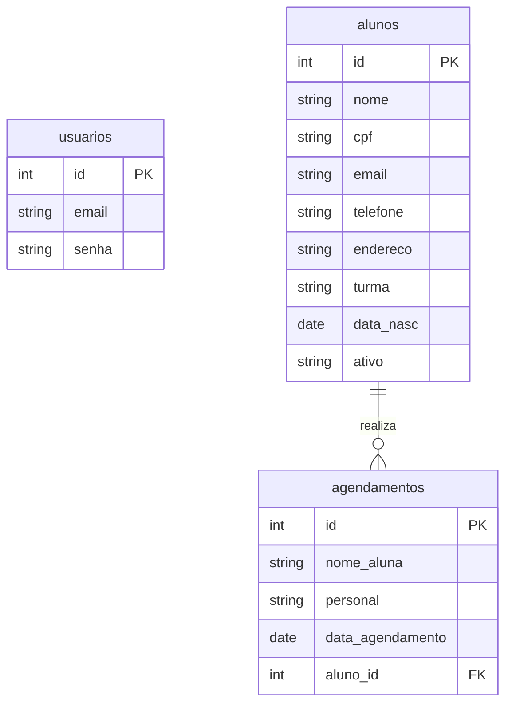

# ProjetoIntegrado
## 1. Projeto

### 1.1. Objetivo
Esse projeto, da Girl Power é uma academia que é apenas para mulheres, para aquelas que não se sentem confortaveis treinando em públuco masculino. O objetivo foi facilitar o atendimento e agendamento de quem paga para treinar ou para quem pretender treinar, é um site seguro, e visualmente organizado para não ter nenhuma dificuldade, também tem a parte em que as mulheres podem ver qual equipamentos elas vão utilizar na musculação, e escolher qual personal elas se sentem mais confortaveis.

### 1.2. Público
- Alunas e clientes da academia Girl Power.
- Personais Trainers e acompanhamento da agenda dos treinos. 
---

## 2. Requisitos Funcionais (RF)

Os requisitos funcionais são o que o sistema disponibiliza para os usuários:

- RF01: Acesso
  - O sistema permite o login e logout apenas de pessoas já cadastradas.
  - Pessoas sem cadastros que tentarem acessar o MENU, são direcionadas novamente para o início `login` automaticamente. 

- RF02: Início principal
  - O início principal tem que exibir uma mensagem de boas-vindas e um "histórico de agendamentos" e treinos das alunas.
  - No "histórico de agendamentos" deve listar: o nome da aluna, personal que está contratada, data do treino, e os status do agendamento.

- RF03 Agendamento de Personal Trainer:
  - As alunas tem que preencher um formulário de agendamento.
  - O formulário exige: Nome da aluna, a opção de selecionar a personal trainer que deseja e escolher a data do treino.
  - Nas opções de data, utiliza o seletor nativo de calendário 'input type="date"' sem o preenchimento obrigatório de horários.

- RF04: Cancelamento de Agendamentos:
  - No *histórico de agendamento*, cada registro tem a opção de cancelamento ´delete.php´.
  - Antes de qualquer cancelamento, o sistema solicita uma confirmação de cancelamento, para evitar exclusões acidentais.

- RF05: Consulta de Equipamentos:
  - A página de equipamentos deve exibir uma galeria organizada com as fotos, nomes e descrições dos aparelhos disponíveis na academia.
---

## 3. Requisitos Não Funcionais (RNF)

Os requisitos não funcionais define a estética, a organização e qualquer critério de uso:

- RNF01: Visibilidade
  - A interface tem que seguir com um padrão visual de cores em tons de rosa, branco e cinza suave. 
  - Uso da tipografia *Poppins* ou fontes *sans-serif*.
  - O MENU do aplicativo garante que o usuário navague entre o *início*, *equipamentos* e *agendar personal* de qualquer página

- RNF02
  - As páginas (tabelas, menus e equipamentos) tem que se adaptar a telas de computadores, tablets e smartphones.

- RNF03: Organização e Dados
  - O App foi desenvolvido em PHP. 
  - O banco de dados foi feita pelo `PDO` com o banco `PostgreSLQ`.
  - O banco organiza as informações nas tabelas alunos, usuarios e agendamentos.

- RNF04: Estrutura do Projeto e Organização de Código
  - Existe uma separação entre: `includes/header.php`, `includes/footer.php`, `login/verifica_user.php`.
  - Separação dos scripts *atualizar_banco.php* para criação e sincronização das tabelas no PostgreSQL.

---

## 4. Resumo 

Durante o desenvolvimento da aplicação, foram realizadas as seguintes etapas e melhorias:

- Navegação:
   - Criação de um menu de navegação único `includes/header.php`, corrigindo as duplicações de cabeçalho no layout e com os links para todas as rotas.

- Criação dos Equipamentos:
   - Estruturação da página `app/equipamentos.php` utilizando para exibição dos aparelhos e suas utilidades.

- Construção de Agendamentos:
   - A página `app/select_w.php` no PostgreSQL para listar em tempo real todos os treinos marcados.
   - O botão de ação *Apagar* para permitir remover os registros do `delete.php`.

- Ajuste e Formulário:
   - Correção do tipo de entrada do formulário de agendamento `app/update.php` para `type="date"`, resolvendo problemas no navegador que impediam o envio do formulário.

- Estrutura do Banco de Dados no PostgreSQL:
   - Permissões no PostgreSQL e criação da tabela *agendamentos* com chave primária e data/hora (TIMESTAMP).
   - Disponibilização do script `atualizar_banco.php` para garantir a criação automática e atualização das tabelas.


 ##  Meu Project Backlog

Abaixo dividi as tarefas do projeto entre o que já entreguei e o que pretendo implementar nas próximas etapas.

---

### O que já foi feito

- Proteção das telas: Bloquear o acesso direto das páginas da pasta `app/` para que só quem fez login consiga usar.
- Ajuste no menu: Corrigir a duplicação do cabeçalho e deixar o `header.php` fixo no topo de todas as páginas.
- Formulário de agendamento: Criar a tela `update.php` para cadastrar novos treinos salvando o nome da aluna, personal e data.
- Correção no campo de data: Mudar o campo do formulário para `type="date"` para resolver o erro do navegador ao enviar.
- Histórico de agendamentAos: Exibir na página `select_w.php` a tabela com todos os treinos cadastrados no PostgreSQL.
- Opção de apagar treino: Adicionar o botão de deletar na tabela e criar o script `delete.php` com o aviso de confirmação.
- Catálogo de equipamentos: Montar a página `equipamentos.php` com fotos e descrições dos aparelhos da academia.
- Script de banco de dados: Criar o arquivo `atualizar_banco.php` para gerar as tabelas no banco de dados sem precisar rodar comandos SQL.

---
## DER


### Próximas melhorias 

-  Pesquisa na tabela: Criar um campo de busca no painel para filtrar os agendamentos pelo nome da aluna ou da personal.
- Editar agendamento: Permitir alterar a data ou a personal de um treino já marcado em vez de ter que apagar e fazer outro.
- Cadastro de novas personals: Fazer uma tela simples para a administração cadastrar ou remover personal trainers do sistema.
- Notificação no sistema: Mostrar uma mensagem de sucesso no topo da tela quando um agendamento for feito ou cancelado.


## 5 Como Executar o Projeto

Para rodar este projeto na sua máquina, será necessário ter instalado um ambiente de servidor local (**PHP**) e o banco de dados **PostgreSQL**.
## Pré-requisitos

- PHP instalado e configurado;
- PostgreSQL instalado e em execução;
- Navegador web.

### Passo a Passo

#### Passo 01. Baixar o projeto em sua máquina

- Copie a URL desse repositório
```bash
https://github.com/SophiafCanciani1908/projetointregado.git
```
- Abra o Terminal, Prompt de Comando ou Git Bash no seu computador e navegue até a pasta onde deseja salvar o projeto:
```bash
cd caminho/pasta_desejada
```

- Execute o git clone:
```bash
git clone https://github.com/SophiafCanciani1908/projetointregado.git
```

- Acesse a pasta:
```bash
cd projetointregado
```

#### Passo 2: Configurar o Banco de Dados
Juntamente aos arquivos do projeto, você tem acesso ao dump do banco de dados `lumina.sql`, você usará ele neste momento. Siga as instruções abaixo:

- Abra o Terminal, Prompt de Comando ou PowerShell.
- Conecte-se ao PostgreSQL de acordo com seu sistema operacional:

    - Linux/macOS (Terminal):
    ```bash
    sudo -u postgres psql
    ```

    - Windows (Prompt/PowerShell):
    ```bash
    psql -U postgres
    ```

- Crie o banco de dados `academiagirl`:
```sql
DROP DATABASE IF EXISTS academiagirl;
CREATE DATABASE academiagirl;
```

- Crie o usuário lumina com senha:
```bash
CREATE USER postgres WITH PASSWORD 'SENAI@1908';
```

- Altere proprietário do database:
```bash
ALTER DATABASE academiagirl OWNER TO postgres;
```

- Verifique se tudo ocorreu bem (banco de dados e usuário criados)
    - Verificação do banco de dados:
```bash
\l
```
- Saia do usuário postgres:
```bash
\q
```
- Entre, seguindo o caminho abaixo:
```bash
cd /var/www/html/projetointregado/
```

- Estando na raiz do projeto `(pasta projetointregado)`, restaure o banco de dados executando o seguinte comando:
```bash
psql -U postgres -d academiagirl -f backup.sql
```
